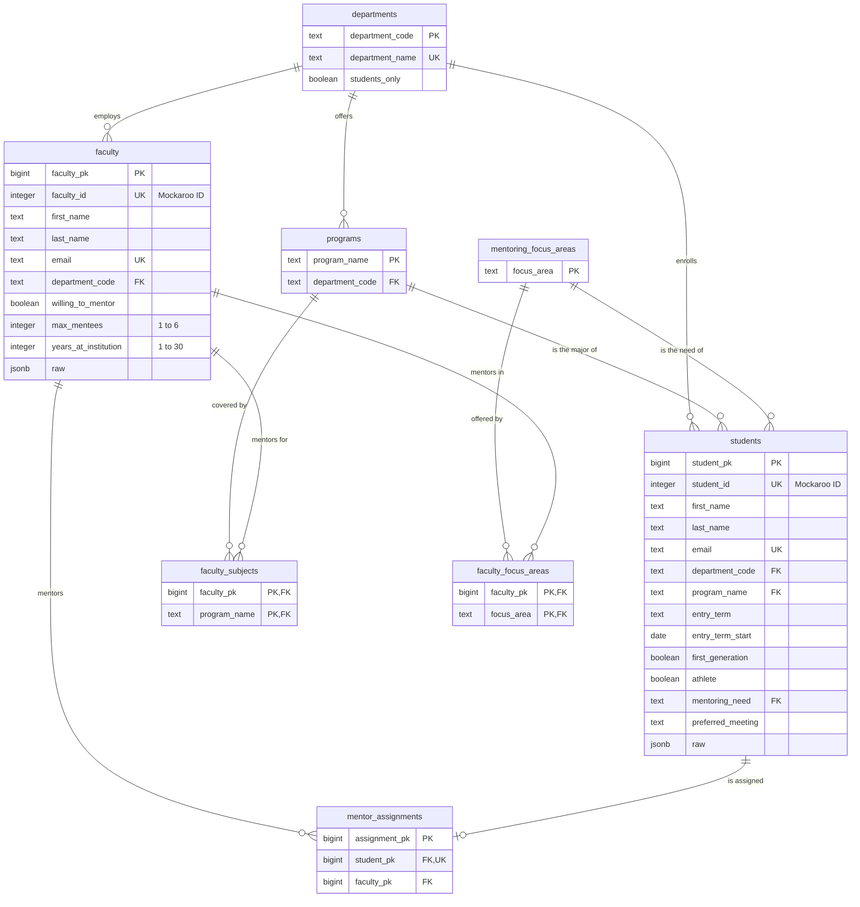

# Database Schema (Week 2)

The database tracks faculty-student mentor groups. It has eight tables in three kinds:
**lookups** (short, fixed lists), **entities** (the people) and **relationships** (links between them).
The full SQL is in [`db/schema.sql`](../db/schema.sql).

Every table also has `first_seen_at` and `last_updated_at` (audit columns, left out of the
diagram to keep it readable).

## What one row means

**Lookups**

- **departments:** one academic department at the college, such as MS (Math & Sciences).
  UND (Undeclared) is marked `students_only` because faculty always belong to a real department.
- **programs:** one program (major), such as Nursing, and the department that offers it. Students
  point at a program *and* department together, so a student's program must belong to their department.
- **mentoring_focus_areas:** one kind of mentoring, such as Career Preparation. Faculty strengths
  and student needs both use this one list, so the two sides always use the same words.

**Entities**

- **faculty:** one faculty member: their home department, whether they're willing to mentor, and how
  many mentees they can take.
- **students:** one student in the mentoring program (the main table, 500 rows): their department
  and program, when they started, first-generation and athlete status, what mentoring they need,
  and how they prefer to meet.

**Relationships**

- **faculty_focus_areas:** one row means "this faculty member will mentor in this focus area."
- **faculty_subjects:** one row means "this faculty member can mentor students in this program."
- **mentor_assignments:** one row is one student-mentor pairing. A student with no mentor has no row.
  A student can have only one mentor at a time (`student_pk` is unique).

## Design decision I debated

The main decision that I debated today was putting faculty focus areas in one column on the faculty table as opposed to separate many-to-many tables. I was concerned that some faculty may have multiple subject areas or areas that they would like to work in and I needed to make the design and structure adaptable for the future. Mockaroo only gives one of each so every faculty member has one row in each table. During my meeting with the committee there was concern that mentors have multiple subjects and areas. I actually used this feedback to make the decision, though it was somewhat made with the feedback because it was really the only workable solution for the issue. 

There was a suggestion by Claude: that a flag be inserted, I removed the "is primary" flag, since each faculty member only has one row, I removed that because it is a possible future feature but it is not needed at this point in development. 

In trying to get the databases set up in a way that was adaptable for future use, as I became more accustomed to working with SQL databases, I made the decision to put separate many-to-many tables instead of just having faculty focus areas and subjects as one column on faculty. This is the more involved option and the other option would have been a lot easier. But my hope is that I'll actually be able to use this database in my career.

<!-- TODO (write in your own words): faculty focus areas and subjects as one column on faculty
     vs. separate many-to-many tables.
     Your points from our discussion:
       - faculty feedback: some faculty have multiple subjects and areas they'd like to mentor in
       - one column can only hold one value, so it becomes two junction tables
       - Mockaroo only gives one of each today, so every faculty member has one row in each
       - dropped the AI's "is_primary" flag: with one row each it carries no information
     Second, smaller decision (optional): mentor_assignments as its own table instead of a
     mentor_faculty_id column on students, to make future changes (history, dates) easier. -->

## Rules the database enforces, and ones it deliberately doesn't

Enforced: valid department, program and focus-area values (foreign keys); a program must belong
to the student's department; `max_mentees` 1-6; `years_at_institution` 1-30; one of three meeting
preferences; fake email domains only; at most one mentor per student.

Not enforced on purpose: a faculty member's mentee count staying within `max_mentees`, and
unwilling faculty having no mentees. The data breaks both (40 faculty over capacity; 172 students
assigned to unwilling faculty). Rejecting those rows would hide the problems this system exists
to find, so `db/queries.sql` reports them instead.

`entry_term_start` assumes terms start on January 15 (Spring), June 1 (Summer) and August 20
(Fall). Adjust `TERM_START` in `ingest/load.py` to match the college calendar.
